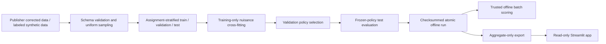

# CounterLift architecture

The app does not load joblib models or train. It verifies aggregate checksums before
reading evidence. Checksums detect corruption; deployment still requires a trusted
publisher and read-only artifact storage. Offline training retains split membership
in SQLite. Baseline features are exactly f0–f11; exposure and visits are excluded.

Source identity includes a Git commit when available, dirty-worktree status and an
implementation content hash. A later documentation-only commit may differ from the
run's recorded implementation commit; hashes preserve the executed source identity.
